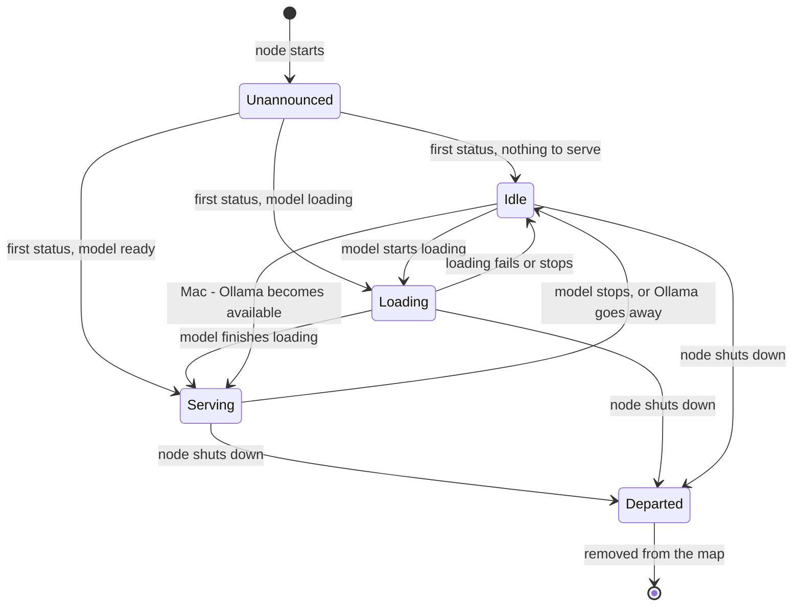

# Sharding status on the map

The map's **Sharding** column shows whether a node is ready to serve
inference. Each node publishes its status to the network every few minutes,
and the map turns that into one of the labels below.

## States

| Map label | Status sent by the node | Meaning |
| --- | --- | --- |
| Serving [x:y] | `ONLINE` (2) | The node has a model loaded and is answering requests for blocks x to y |
| Loading [x:y] | `JOINING` (1), loading | The node is loading blocks x to y and is not ready yet |
| Idle | `JOINING` (1), not loading | The node is up and connected, but has nothing to serve and is not loading anything |
| Departed | `OFFLINE` (0 or -1) | The node shut down cleanly and told the network it was leaving |
| Unannounced | none | The map can see the node, but it hasn't published a status |

The block range `[x:y]` appears only for Serving and Loading. Idle nodes
aren't used for inference, so the map doesn't show a range for them.

## How a node moves between states

## Things worth knowing

- **Changes take a few minutes to appear.** Nodes publish their status
  about every five minutes and the map refreshes every minute, so a change
  can take up to six minutes to appear. Only a clean shutdown is sent right
  away.
- **Idle is the catch-all.** It covers nodes that were never given a model,
  nodes whose model stopped, and Macs whose Ollama isn't running.
- **Older nodes can't report Loading.** Versions from before Loading existed
  show Idle while they load.
- **A crashed node can linger.** A node that crashes never sends Departed,
  so its last status (often Serving) can stay on the map for a while after
  it has gone.
- **Test networks can skip the model check.** A test-only setting lets a
  node report Serving without a model loaded, so connectivity tests show up
  on the map.
